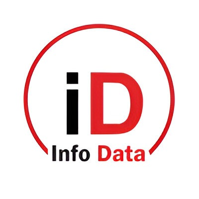

  
  <h1>🚀 ConfirmMe-Approval</h1>
  
<strong>Advanced Dynamic Workflow & Approval System</strong>

  
  
  
  

 

**ConfirmMe-Approval** is a state-of-the-art document approval and workflow management system built on Laravel. It transforms rigid, hardcoded approval hierarchies into a fully dynamic and adaptable workflow engine that scales with modern organizational structures.

---

## ✨ Features & Capabilities

### 🔄 Dynamic Templates & Workflows
No more hardcoded routes! The approval logic is entirely decoupled from the source code. Administrators can build document templates with embedded, flexible JSON-based workflows. The system inherently knows how to route documents based on the chosen template without a single line of `middleware('role:...')` logic.

### 🧠 Hybrid Approver Algorithm
The core of ConfirmMe is its intelligent **Hybrid Approver Algorithm**. When routing a document, the system calculates the next approver dynamically:
1. **Direct User Assignment**: Bypasses roles and points straight to a specific user.
2. **Meta-Role Detection**: Understands hierarchical contexts (e.g., dynamically finding the "Director" of the requester's specific department).
3. **Department Isolation**: Ensures cross-department collision does not happen. "Manager of IT" will only approve "IT Staff" documents.
4. **Global Fallback**: Falls back to global roles for company-wide positions (e.g., Finance or HR).

### 🌍 Multi-language & AI Localization
Fully integrated translation engine supporting multiple languages (ID, EN). New keys can be automatically extracted via synchronization scripts and localized using built-in AI Translation scripts (`translate_en.py`, `translate_id.py`), ensuring a seamless experience for both local and international executives.

### 🛡️ Zero Hardcode Policy & Fallback Security
Strict architectural guidelines prevent hardcoded roles in controllers and routes. Features adapt to newly created organizational roles instantly. For unseen or undefined roles, the system enforces strict fallback data protection to prevent accidental data leaks.

### 💼 Comprehensive Modules
- **Finance**: Budget Tracking, Purchase Orders (PO), Invoices, Employee Loans.
- **HR / People**: Leave Requests, Geofenced Attendance tracking.
- **Executive**: High-level Dashboards, bulk approvals, announcements.

---

## 🛠️ Tech Stack

- **Backend**: [Laravel](https://laravel.com/) (PHP)
- **Frontend**: Blade Templates, [Alpine.js](https://alpinejs.dev/)
- **Styling**: [Tailwind CSS](https://tailwindcss.com/)
- **Icons**: Phosphor Icons / Heroicons

---

## 👨‍💻 Author & Contact

**Sahrul Ramadhani**
- 📧 Email: sahrul.r.dhani@gmail.com
- 🐙 GitHub: [@SahrulRD-Smatel](https://github.com/SahrulRD-Smatel)

---

## 📄 License

This project is licensed under the [MIT License](LICENSE) - see the LICENSE file for details.

 

  <i>Built with passion for seamless enterprise automation.</i>

