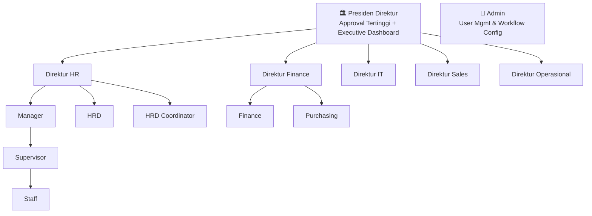
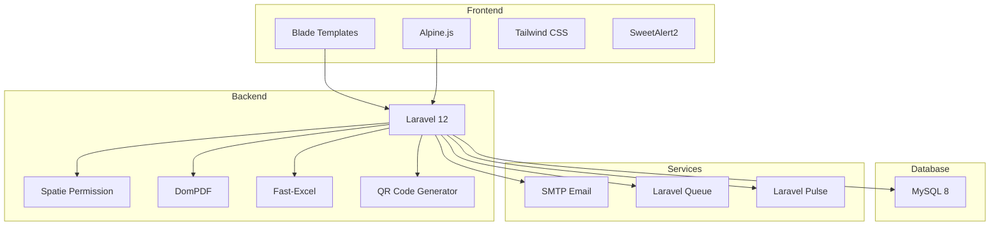

# ConfirmMe — Enterprise Document Approval & HRIS Platform

> **Role:** Full-Stack Developer (Solo)  
> **Period:** 2025 – 2026  
> **Category:** Enterprise Web Application  
> **Live URL:** [confirmme.sahrulrdhani.my.id](https://confirmme.sahrulrdhani.my.id)  
> **Source Code:** [GitHub - ConfirmMe-Approval](https://github.com/SahrulRD-Smatel/ConfirmMe-Approval)

---

## PROJECT OVERVIEW

**ConfirmMe** adalah platform enterprise untuk otomasi approval dokumen dan manajemen SDM (HRIS) yang dirancang untuk kebutuhan perusahaan multi-divisi. Sistem ini mengotomasi seluruh siklus pengajuan dokumen — mulai dari pembuatan, approval chain berjenjang, hingga arsip digital — dengan kontrol akses berbasis role yang granular.

Dibangun sebagai solusi end-to-end, ConfirmMe mengintegrasikan modul keuangan (Budget, PO, Invoice, Pinjaman Karyawan), manajemen absensi, pengajuan cuti, executive dashboard untuk Presiden Direktur, serta verifikasi dokumen publik via QR Code.

---

## TECH ARCHITECTURE

| Layer | Technology |
|-------|-----------|
| **Backend** | Laravel 12 (PHP 8.2+) |
| **Frontend** | Blade Templates + Alpine.js |
| **CSS** | Tailwind CSS 3/4 |
| **Database** | MySQL 8 |
| **Auth & RBAC** | Laravel Breeze + Spatie Permission |
| **PDF Generation** | DomPDF |
| **QR Code** | SimpleSoftwareIO QR Code |
| **Excel/Spreadsheet** | Rap2hpoutre Fast-Excel |
| **Build Tool** | Vite 7 |
| **E2E Testing** | Playwright |
| **Static Analysis** | PHPStan / Larastan |
| **Monitoring** | Laravel Pulse |
| **Alert/Notification** | Email SMTP + In-App + SweetAlert2 |

---

## ROLE-BASED ACCESS CONTROL (RBAC)

ConfirmMe mengimplementasikan **14 role** dengan permission granular menggunakan Spatie Laravel Permission:



---

## SCREENSHOT & PENJELASAN PER ROLE

### 👤 1. STAFF / SUPERVISOR — Dashboard

Sebagai role dasar, Staff dapat membuat pengajuan dokumen, mengajukan cuti, melakukan check-in absensi, dan melihat pengumuman perusahaan. Supervisor mendapat tambahan fitur approval dan monitoring tim.


**Fitur pada Dashboard:**
- **Greeting personal** dengan jam real-time
- **User card** menampilkan nama, jabatan, sisa cuti, dan hari sakit
- **Quick Links** untuk akses cepat ke Edit Profil & Request Cuti
- **Feed Terbaru** — Pengumuman dari Admin dengan attachment file
- **Who's Off Today** — Siapa yang sedang cuti hari ini

---

### ✅ 2. SUPERVISOR — Approval Queue & Team Documents

Supervisor memiliki kemampuan menyetujui/menolak dokumen dan memantau dokumen tim.

````carousel

<!-- slide -->

````

**Fitur Approval Queue:**
- Filter berdasarkan **Prioritas** dan **Jenis** dokumen
- Opsi **Bulk Approval** untuk proses massal
- **Riwayat Approval** — Rekam jejak keputusan yang telah dibuat

**Fitur Team Documents:**
- Tabel monitoring dokumen tim per departemen
- Supervisor hanya melihat dokumen dari timnya sendiri

---

### 👤 3. PROFILE — Manajemen Profil


**Fitur Profile:**
- **Informasi Jabatan** — Role, Jabatan, Departemen, Divisi, Employee ID
- **Edit Profile** — Nama, Email, Foto Avatar
- **Update Password** — Ganti password dengan validasi
- **Data Bank** — Untuk keperluan finance/loan

---

### 💰 4. FINANCE MANAGER — Dashboard Keuangan

Finance Manager mendapatkan dashboard terintegrasi untuk overview keuangan perusahaan.


**Dashboard Finance mencakup:**
- **Financial Health** — Total Budget (Rp 1,8M), Committed PO, Terpakai (Actual), Sisa Budget
- **Progress bar** persentase pemakaian anggaran
- **Invoice Outstanding** & **Pending Invoice (PO)**
- **Analytics** — Cash Flow (YTD), Budget vs Actual, Distribusi
- **Pinjaman Karyawan** — Total outstanding, aktif, menunggu cair

---

### 📊 5. FINANCE — Budget, PO, Invoice & Loans


````carousel

<!-- slide -->

<!-- slide -->

<!-- slide -->

````

| Sub-Module | Fitur |
|------------|-------|
| **Budget** | Multi tahun fiskal, progress tracking, CRUD |
| **Purchase Order** | Draft → Issued → Received, Print PDF |
| **Invoice** | Generate dari PO, Payment recording, Print |
| **Pinjaman** | Disbursement, Repayment, Laporan piutang |

---

### 🏛️ 6. PRESIDEN DIREKTUR — Executive Dashboard

Dashboard khusus dengan bird's-eye view seluruh operasional perusahaan.


**Executive Dashboard menampilkan:**
- **Menunggu Approval** — Jumlah dokumen yang perlu keputusan
- **Total Nilai Pending** — Nominal dokumen belum disetujui
- **Urgent & Overdue (>7 hari)** — Dokumen melebihi batas waktu
- **Grafik Pengeluaran 6 Bulan Terakhir**
- **Distribusi per Divisi (Tahun Ini)**

---

### 📈 7. EXECUTIVE — Company Insights & Reports

````carousel

<!-- slide -->

<!-- slide -->

````

**Company Insights:** KPI keuangan, Rata-rata Waktu Approval, Grafik Pengeluaran Bulanan

**Laporan & Statistik:** Statistik berwarna, Chart Tren, Komposisi Dokumen, Export PDF

---

## FITUR UTAMA LENGKAP

### 📄 Document Management System
- **6 Template Dokumen:** Pengadaan Barang, Reimbursement, Perjalanan Dinas, Cuti, Pembelian Bulk, Pinjaman Karyawan
- **Multi-step Approval Chain** yang dapat dikonfigurasi per template
- **Dynamic Workflow** — Admin mengatur chain, threshold, dan akses per role
- **Attachment Support** — Upload file pendukung
- **Comment Thread** — Diskusi dalam dokumen
- **QR Code Verification** — Verifikasi keaslian dokumen publik
- **PDF Generation** — Cetak dokumen resmi dengan QR Code
- **2FA Verification** — OTP untuk approval level Direktur/Presiden

### 👥 HRIS Module
- **Attendance** — Check-in/Out berbasis lokasi (GPS), riwayat kehadiran
- **Leave Management** — Pengajuan cuti dengan approval 4 tingkat
- **Announcements** — Pengumuman perusahaan dengan file attachment
- **Employee Loans** — Pengajuan dan tracking pinjaman karyawan

### 💰 Finance Module
- **Budget Management** — Alokasi anggaran per departemen per tahun fiskal
- **Purchase Orders** — Pembuatan, approval, dan tracking PO
- **Invoice Management** — Generate invoice, payment recording
- **Employee Loan** — Pencairan, cicilan, dan laporan piutang

### 🔧 Admin Panel
- **User Management** — CRUD user, assign role, toggle active/inactive
- **Role & Permission** — Manajemen role dan hak akses
- **Workflow Configuration** — Dynamic approval chain, nominal threshold
- **Document Templates** — Kelola template dokumen
- **Department Management** — Kelola struktur departemen
- **Audit Log** — Log aktivitas sistem dengan export

### 📊 Reporting & Analytics
- **Laporan Dokumen** — Statistik per status, departemen, tren waktu
- **Laporan Keuangan** — Cash flow, budget vs actual, distribusi
- **Export** — PDF & Excel/CSV export
- **Executive Dashboard** — Bird's-eye view untuk manajemen puncak

---

## ARSITEKTUR TEKNIS



### Database Schema (25+ Tables)
| Category | Tables |
|----------|--------|
| **Core** | users, documents, document_attachments, document_comments |
| **Approval** | document_approvals, approval_logs, workflow_chains, approval_thresholds, workflow_settings |
| **Finance** | budgets, purchase_orders, purchase_order_items, invoices |
| **Loans** | employee_loans, loan_repayments, loan_fund_settings |
| **HRIS** | attendances, office_locations, leave_requests, announcements |
| **Admin** | roles, permissions, departments, document_templates, audit_logs, email_templates |

---

## HIGHLIGHT TEKNIS

| Aspek | Detail |
|-------|--------|
| **47 Migration Files** | Evolusi schema yang iterative dan terstruktur |
| **25 Eloquent Models** | Dengan relationships, accessors, dan business logic |
| **18+ Controllers** | Clean separation of concerns per module |
| **14 User Roles** | Granular permission-based access control |
| **Multi-level Approval** | Staff → Supervisor → Manager → HRD → Direktur → Presiden |
| **2FA OTP** | Untuk approval level executive |
| **QR Code Verification** | Public document verification |
| **PDF Export** | Document, PO, Invoice, dan Reports |
| **Excel Import/Export** | Attendance data bulk operations |
| **E2E Testing** | Playwright test suite |
| **Static Analysis** | PHPStan / Larastan |
| **Real-time Monitoring** | Laravel Pulse integration |

---

## LINKEDIN DESCRIPTION (Copy-Paste Ready)

### Post Singkat:

> 🚀 **ConfirmMe** — Enterprise Document Approval & HRIS Platform
>
> Built a full-stack enterprise system that automates multi-level document approval workflows for a corporate environment. Key features:
>
> ✅ 14 role-based user types with granular permissions  
> ✅ Dynamic approval chains (Staff → Supervisor → Manager → Director → President)  
> ✅ Finance module: Budget, PO, Invoice & Employee Loan management  
> ✅ HRIS features: Attendance, Leave Management, Announcements  
> ✅ Executive Dashboard with company-wide KPIs & analytics  
> ✅ QR Code document verification & 2FA for executive approvals  
> ✅ PDF/Excel export capabilities  
>
> Tech: Laravel 12 · MySQL · Alpine.js · Tailwind CSS · Spatie Permission · DomPDF · Playwright
>
> #Laravel #PHP #FullStack #WebDevelopment #HRIS #Enterprise

### Deskripsi Lengkap untuk Portfolio:

> **ConfirmMe** is an enterprise-grade document approval and HRIS platform engineered to streamline corporate governance through a centralized digital ecosystem. As the sole developer, I architected a role-based system supporting 14 distinct user roles — from Staff to President Director — with configurable multi-step approval workflows.
>
> The platform features a comprehensive finance module (budgets, purchase orders, invoices, employee loans), an HRIS suite (attendance tracking, leave management, company announcements), and an executive dashboard providing strategic KPIs and analytics. Security features include 2FA OTP verification for executive approvals and QR code-based public document verification.
>
> Built on Laravel 12 with MySQL, the system handles complex business logic including dynamic workflow chains, nominal-based approval thresholds, multi-division budget management, and comprehensive audit logging — all deployed as a production-ready, mobile-responsive web application.
