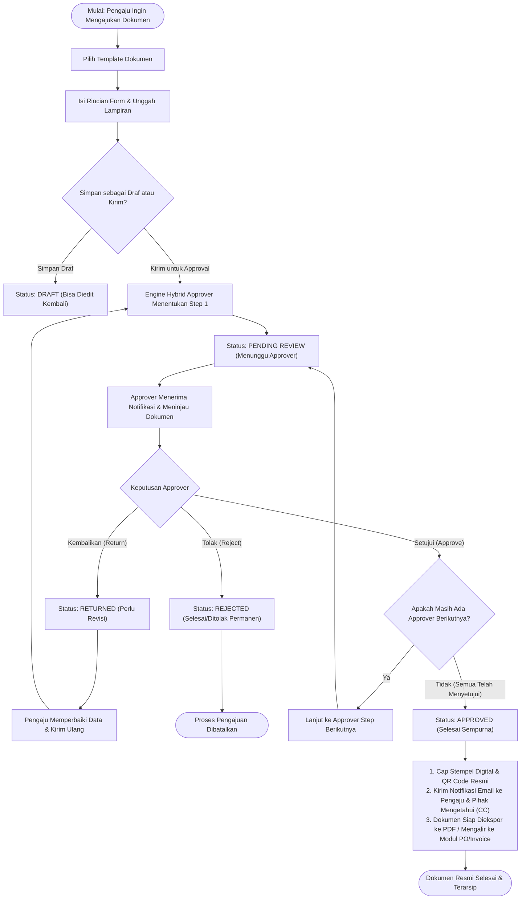
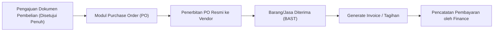

# BUKU PANDUAN PENGGUNA (MANUAL BOOK)
# SISTEM APPROVAL DOKUMEN — CONFIRMME

> **Dokumen:** Panduan Operasional Sistem (*User Manual Guide*)  
> **Aplikasi:** ConfirmMe-Approval Enterprise Platform  
> **Cakupan:** Siklus Pengajuan Dokumen Lengkap (*End-to-End Approval Cycle*)  
> **Versi Dokumen:** 2.0 (Dinamis & Multi-Modul)

---

## DAFTAR ISI

1. [Gambaran Umum Sistem](#1-gambaran-umum-sistem)
2. [Hierarki Peran & Hak Akses](#2-hierarki-peran--hak-akses)
3. [Alur Siklus Hidup Dokumen (End-to-End Workflow)](#3-alur-siklus-hidup-dokumen-end-to-end-workflow)
4. [Panduan Pengaju (Requester): Membuat Pengajuan Baru](#4-panduan-pengaju-requester-membuat-pengajuan-baru)
5. [Logika Routing Dinamis (Hybrid Approver & Pihak Mengetahui)](#5-logika-routing-dinamis-hybrid-approver--pihak-mengetahui)
6. [Panduan Approver: Memeriksa & Memberikan Keputusan](#6-panduan-approver-memeriksa--memberikan-keputusan)
7. [Prosedur Revisi Dokumen (Jika Dikembalikan)](#7-prosedur-revisi-dokumen-jika-dikembalikan)
8. [Penyelesaian Dokumen (Final Approval & Notifikasi Tembusan)](#8-penyelesaian-dokumen-final-approval--notifikasi-tembusan)
9. [Fitur Keamanan: Tanda Tangan Digital, QR Code & 2FA OTP](#9-fitur-keamanan-tanda-tangan-digital-qr-code--2fa-otp)
10. [Integrasi Lanjutan: Alur ke Purchase Order (PO) & Invoice](#10-integrasi-lanjutan-alur-ke-purchase-order-po--invoice)
11. [Tanya Jawab & Pemecahan Masalah (FAQ)](#11-tanya-jawab--pemecahan-masalah-faq)

---

## 1. GAMBARAN UMUM SISTEM

**ConfirmMe-Approval** adalah platform tata kelola dokumen persetujuan (*digital approval workflow*) terintegrasi yang menggantikan birokrasi tanda tangan fisik berbasis kertas (*paperless governance*). 

Sistem ini dirancang berbasis **Zero Hardcoding & Dynamic Workflow**, di mana:
- Seluruh formulir pengajuan dan susunan rantai pemeriksa dikendalikan melalui **Template Dokumen**.
- Approver ditentukan secara cerdas (*Hybrid Approver*) berdasarkan hierarki divisi pengaju tanpa perlu konfigurasi kaku pada kode sumber.
- Dokumen yang disetujui memiliki stempel digital dan **QR Code** resmi yang dapat diverifikasi keasliannya secara publik.

---

## 2. HIERARKI PERAN & HAK AKSES

Setiap akun pengguna di ConfirmMe memiliki hak akses granular berdasarkan peran (*role*) dan departemen:

| Kategori Peran | Contoh Role | Wewenang Utama |
| :--- | :--- | :--- |
| **Requester (Pengaju)** | Staff, Operator, Admin Dept | Membuat permohonan pengajuan, melampirkan berkas, menyimpan draf, dan melakukan revisi jika diminta. |
| **Direct Approver** | Supervisor, Section Head | Memeriksa kelayakan teknis, verifikasi rincian data per departemen internal. |
| **Managerial Approver** | Manager, Department Head | Persetujuan manajerial, verifikasi kesesuaian anggaran divisi. |
| **Central / Functional** | HRD, GA, Finance, Purchasing | Review fungsional khusus (misal: verifikasi kas oleh Finance, kepatuhan barang oleh GA). |
| **Executive Approver** | Direktur Divisi, Presiden Direktur | Pengambilan keputusan strategis, persetujuan nominal bernilai tinggi, otentikasi via 2FA OTP. |
| **Pihak Mengetahui (CC)** | General Affairs (GA), IT Admin, Admin Ops | Memantau dokumen, menerima tembusan notifikasi & email saat dokumen selesai disetujui, tanpa perlu menandatangani persetujuan. |

---

## 3. ALUR SIKLUS HIDUP DOKUMEN (END-TO-END WORKFLOW)

Diagram alir berikut menggambarkan perjalanan sebuah dokumen dari inisiasi draf hingga pengarsipan resmi:



---

## 4. PANDUAN PENGAJU (REQUESTER): MEMBUAT PENGAJUAN BARU

### Langkah 1: Membuka Menu Pengajuan
1. Buka tautan dashboard aplikasi ConfirmMe dan masuk (*login*) menggunakan akun Anda.
2. Di sidebar navigasi kiri, klik menu **Buat Pengajuan** (*Create Request*) atau klik tombol **Buat Pengajuan** pada kartu *Tautan Cepat* di Dashboard Workspace.

### Langkah 2: Memilih Template Dokumen
1. Sistem akan menampilkan katalog template dokumen yang tersedia untuk departemen Anda (misalnya: *Surat Ijin Keluar/Masuk Barang Gudang*, *Permintaan Pembelian Barang*, *Dokumen Khusus IT Internal*, atau *Reimbursement Biaya*).
2. Klik tombol **Pilih Dokumen** pada template yang sesuai dengan kebutuhan pengajuan Anda.

> [!TIP]
> **Multi-Module Submission:** Anda dapat menambahkan lebih dari satu jenis dokumen pengajuan sekaligus dalam satu draf pengajuan dengan menekan tombol **Tambah Dokumen Lain** sebelum mengirim.

### Langkah 3: Mengisi Informasi Utama Dokumen
Lengkapi formulir informasi umum:
- **Judul Dokumen:** Berikan judul yang jelas dan deskriptif (contoh: *"Pengadaan 5 Unit Laptop Divisi Operasional"*).
- **Nomor Dokumen:** Nomor akan dibuat otomatis oleh sistem (*Auto-generated*), namun dapat disesuaikan jika organisasi Anda memiliki format penomoran manual.
- **Departemen:** Terisi otomatis sesuai departemen akun Anda.
- **Tingkat Prioritas:**
  - `Low` (Rendah): Pengajuan rutin tanpa batasan waktu mendesak.
  - `Normal` (Standar): Alur kerja operasional umum (standar SLA 1–3 hari kerja).
  - `High` (Tinggi): Memerlukan tindak lanjut cepat dari pimpinan.
  - `Urgent` (Mendesak): Situasi darurat operasional. Dokumen akan ditandai dengan badge merah berkedip di antrean pemeriksa.
- **Tanggal Dokumen:** Tanggal pengajuan dibuat.

### Langkah 4: Mengisi Bidang Dinamis (Dynamic Fields)
Setiap template memiliki kolom khusus yang telah ditentukan oleh Administrator:
- **Nominal Rupiah (Mata Uang):** Sistem secara otomatis memformat pemisah ribuan saat Anda mengetik nominal (misalnya mengetik `25000000` otomatis terformat menjadi `Rp 25.000.000`).
- **Kalkulasi Otomatis Pajak (DPP & PPN 11%):** Pada pengajuan pembelian/pengadaan, sistem menghitung besaran PPN 11% dan *Jumlah Keseluruhan* secara otomatis saat Subtotal DPP diisi.
- **Keterangan Tambahan / Justifikasi:** Masukkan alasan operasional atau rincian teknis pengajuan.

### Langkah 5: Melampirkan Berkas Pendukung (Attachments)
1. Pada bagian **Lampiran Dokumen**, seret file pendukung ke dalam area unggah (*drag & drop*) atau klik untuk memilih file dari komputer Anda.
2. Format file yang didukung: **PDF, Word (.docx), Excel (.xlsx), dan Gambar (JPG/PNG)** dengan batas ukuran maksimal per file 10MB.
3. Pastikan lampiran penting (seperti *quotation vendor*, foto barang rusak, atau surat tugas) telah diunggah sebelum pengajuan dikirim.

### Langkah 6: Menyimpan Draf vs Kirim Pengajuan
- **Simpan Draf:** Dokumen disimpan dengan status `Draft`. Approver belum dapat melihat dokumen ini, dan Anda dapat mengedit isian kembali kapan saja melalui menu *Daftar Dokumen*.
- **Kirim untuk Approval:** Dokumen langsung masuk ke antrean pemeriksa pertama. Status dokumen berubah menjadi `Pending Review`.

---

## 5. LOGIKA ROUTING DINAMIS (HYBRID APPROVER & PIHAK MENGETAHUI)

Aplikasi ConfirmMe menggunakan algoritma **Hybrid Approver** yang cerdas dan adil:

### 1. Penentuan Rantai Approver (Chain Execution)
Persetujuan diproses secara berurutan (*step-by-step*) dari urutan paling atas ke paling bawah:
1. **Pemeriksa Langsung (Supervisor / Manager Departemen):** Sistem mendeteksi siapa atasan di departemen pengaju. Pengaju dari departemen *Operations* hanya akan ditinjau oleh Manager *Operations*, bukan Manager departemen lain.
2. **Pemeriksa Fungsional / Sentral:** Untuk dokumen tertentu, alur dapat diarahkan ke tim fungsional terpusat (contoh: General Affairs untuk sarana, IT untuk permohonan perangkat/email, atau Finance untuk persetujuan anggaran).
3. **Pemeriksa Tingkat Direksi:** Jika nilai nominal melampaui batas ambang (*threshold*), atau jika template mewajibkan pengesahan Direktur Operasional / Direktur Keuangan / Presiden Direktur, dokumen akan dialirkan otomatis ke tingkat eksekutif.

### 2. Fitur Pihak Mengetahui / Tembusan (CC)
Selain pemeriksa (*Approver*), Administrator dapat menentukan **Pihak Mengetahui (Tembusan / CC)** pada template:
- Pihak ini **TIDAK PERLU** menandatangani atau memvalidasi approval pada antrean persetujuan.
- Pihak ini memiliki **Hak Akses Khusus** untuk membuka dan membaca berkas dokumen.
- Saat dokumen telah **selesai disetujui secara final**, sistem otomatis mengirimkan:
  - Notifikasi instan di dalam aplikasi (*In-App Notification*).
  - Tembusan email resmi (*Email CC Notification*) berisi tautan berkas dan ringkasan persetujuan.

---

## 6. PANDUAN APPROVER: MEMERIKSA & MEMBERIKAN KEPUTUSAN

### Langkah 1: Membuka Antrean Approval (Approval Queue)
1. Masuk ke aplikasi menggunakan akun pemeriksa Anda.
2. Buka menu **Antrean Approval** pada bilah navigasi kiri. Angka pada lencana (*badge*) merah menunjukkan jumlah dokumen yang memerlukan tindakan Anda.
3. Anda dapat menyaring antrean berdasarkan:
   - **Tingkat Prioritas** (Urgent, High, Normal, Low)
   - **Jenis Dokumen / Template**
   - **Pencarian Nomor Dokumen atau Nama Pengaju**

### Langkah 2: Meninjau Rincian Dokumen
Klik pada baris dokumen untuk membuka halaman **Detail Dokumen**:
- Periksa kesesuaian judul, nomor dokumen, nominal, dan justifikasi pengajuan.
- Klik file pada bagian **Lampiran** untuk melihat atau mengunduh dokumen pendukung.
- Tinjau bagan **Jejak Persetujuan (Workflow Timeline)** untuk melihat siapa saja yang telah menyetujui dokumen ini pada tahap sebelumnya beserta catatan mereka.

### Langkah 3: Menggunakan Kolom Diskusi / Komentar
Jika Anda memerlukan klarifikasi sebelum memutuskan:
1. Gunakan kotak **Komentar** di bagian bawah halaman.
2. Ketik pertanyaan Anda dan klik tombol **Kirim Komentar**. Pengaju dan sesama approver akan menerima notifikasi pesan baru.

### Langkah 4: Mengambil Tindakan Keputusan

Tersedia tiga opsi keputusan utama bagi pemeriksa:

```
+-------------------------------------------------------------------------+
|                           PILIHAN TINDAKAN                              |
+---------------------+-------------------------+-------------------------+
|  1. SETUJUI         |  2. KEMBALIKAN (REVISI) |  3. TOLAK DOKUMEN       |
|     (APPROVE)       |     (RETURN / REVISE)   |     (REJECT)            |
+---------------------+-------------------------+-------------------------+
| Menyetujui dokumen  | Mengembalikan berkas    | Membatalkan pengajuan   |
| dan meneruskan ke   | ke pengaju untuk        | secara permanen. Alasan |
| tahap berikutnya /  | diperbaiki. Wajib       | penolakan wajib diisi   |
| finalisasi resmi.   | menyertakan catatan.    | untuk audit trail.      |
+---------------------+-------------------------+-------------------------+
```

1. **Tombol "Setujui Dokumen":**
   - Klik tombol hijau **Setujui Dokumen**.
   - Masukkan catatan persetujuan opsional.
   - *Catatan Khusus Direksi:* Jika akun Anda memiliki peran *Direktur* atau *Presiden Direktur* dan fitur 2FA OTP aktif di sistem, jendela dialog akan meminta kode OTP 6 digit yang dikirimkan ke email Anda. Masukkan kode tersebut untuk memverifikasi keabsahan tanda tangan.

2. **Tombol "Kembalikan untuk Revisi":**
   - Jika terdapat data nominal yang keliru atau lampiran yang kurang lengkap, klik tombol oranye **Kembalikan**.
   - Tuliskan instruksi perbaikan yang jelas pada kolom alasan.
   - Dokumen akan dikembalikan ke status `Returned`.

3. **Tombol "Tolak Pengajuan":**
   - Jika pengajuan tidak disetujui karena tidak sesuai kebijakan perusahaan atau ketiadaan anggaran, klik tombol merah **Tolak Dokumen**.
   - Masukkan alasan penolakan secara jelas. Dokumen langsung berpindah status menjadi `Rejected` dan proses dihentikan permanen.

> [!NOTE]
> **Persetujuan Massal (Bulk Approval):**  
> Bagi manajer atau direktur dengan volume pengajuan tinggi, Anda dapat menggunakan tombol centang pada daftar antrean dokumen dan menekan tombol **Setujui yang Dipilih** (*Bulk Approve*) untuk memproses beberapa dokumen standar sekaligus.

---

## 7. PROSEDUR REVISI DOKUMEN (JIKA DIKEMBALIKAN)

Jika dokumen Anda dikembalikan oleh salah satu approver:

1. Anda akan menerima notifikasi lonceng di aplikasi serta pemberitahuan melalui email bahwa dokumen memerlukan perbaikan.
2. Buka menu **Daftar Dokumen**, cari dokumen dengan badge status oranye `Returned` (Dikembalikan).
3. Klik tombol **Edit Dokumen**.
4. Baca pesan pengembalian dari approver di bagian atas form.
5. Perbaiki nilai isian, ganti file lampiran yang diminta, atau tambahkan keterangan pendukung.
6. Klik tombol **Kirim Ulang untuk Approval** (*Resubmit*).
7. Dokumen akan memulai siklus persetujuan kembali secara tertib agar seluruh pemeriksa mendapatkan versi berkas yang telah diperbaiki.

---

## 8. PENYELESAIAN DOKUMEN (FINAL APPROVAL & NOTIFIKASI TEMBUSAN)

Ketika approver terakhir pada rantai template telah menekan tombol *Setujui*:

1. **Status Dokumen Berubah:** Status dokumen secara otomatis berubah menjadi `Approved` (Selesai Disetujui) berwarna hijau.
2. **Notifikasi Pengaju:** Pengaju menerima notifikasi ucapan selamat dan email resmi bahwa dokumen telah disetujui penuh.
3. **Penyaluran Notifikasi ke Pihak Mengetahui (Tembusan / CC):**
   - Sistem secara otomatis mengirimkan notifikasi dan email tembusan kepada seluruh pihak yang terdaftar pada kolom *Pihak Mengetahui* (misalnya: Tim GA, Admin Ops, atau Tim IT).
   - Seluruh pihak tembusan dapat langsung mengklik tautan dokumen untuk melakukan tindak lanjut operasional (misalnya: mengeluarkan barang gudang, memproses peminjaman kendaraan, atau menyiapkan akun email).
4. **Pengarsipan Otomatis:** Dokumen tersimpan aman di database arsip digital perusahaan dan riwayat auditnya tercatat permanen (*Audit Trail*).

---

## 9. FITUR KEAMANAN: TANDA TANGAN DIGITAL, QR CODE & 2FA OTP

Untuk menjamin integritas hukum dan kepatuhan audit internal:

### 1. Blok Tanda Tangan Digital (Digital Stamp Block)
Pada berkas pengajuan dan cetakan PDF resmi, ConfirmMe mencantumkan blok verifikasi digital yang memuat:
- Nama lengkap approver.
- Jabatan dan peran dalam workflow.
- Tanggal dan jam persetujuan hingga detik (*Timestamp* presisi).
- Hash identifikasi persetujuan unik.

### 2. Verifikasi Publik via QR Code
- Setiap dokumen resmi dilengkapi dengan **QR Code Unik**.
- Siapapun (termasuk staf lapangan atau pihak eksternal yang memegang cetakan fisik dokumen) dapat memindai QR Code tersebut menggunakan kamera ponsel.
- Pemindaian akan mengarahkan ke halaman publik verifikasi resmi ConfirmMe (`/verify/{hash}`):
  - Memvalidasi bahwa dokumen tersebut **ASLI dan Terdaftar**.
  - Menampilkan status dokumen terkini, nama pengaju, nilai nominal, dan tanggal disetujui penuh.
  - Mencegah manipulasi angka atau pemalsuan dokumen cetak.

### 3. Otentikasi Dua Langkah (2FA Security OTP)
- Khusus persetujuan bernilai strategis di tingkat Direktur dan Presiden Direktur, sistem menyediakan opsi perlindungan OTP (*One-Time Password*).
- Kode OTP acak 6 digit akan dikirimkan ke email resmi pejabat eksekutif dan hanya berlaku selama 10 menit untuk mencegah penyalahgunaan akun jika perangkat tidak terkunci.

---

## 10. INTEGRASI LANJUTAN: ALUR KE PURCHASE ORDER (PO) & INVOICE

Bagi dokumen bertipe finansial (*Approval to PO* atau *Approval to Invoice*):



1. **Otomasi Purchase Order (PO):**
   - Dokumen permohonan pembelian yang telah selesai disetujui dapat langsung dikonversi menjadi PO resmi melalui tombol **Generate PO**.
   - Tim Purchasing / Finance tidak perlu menginput ulang rincian barang, harga, dan vendor.
2. **Penerbitan Invoice & Pembayaran:**
   - Setelah pesanan PO diterima, invoice vendor dapat dicatat ke dalam sistem dengan nomor referensi PO terkait.
   - Tim Keuangan memantau batas jatuh tempo (*due date*) dan mencatat bukti transfer pelunasan kas keluar.

---

## 11. TANYA JAWAB & PEMECAHAN MASALAH (FAQ)

### Q1: Mengapa dokumen yang saya ajukan belum juga disetujui?
> **Jawaban:** Periksa status dokumen pada halaman *Detail Dokumen*. Lihat diagram rantai persetujuan di kolom kanan. Nama approver yang sedang ditandai dengan lingkaran biru atau status *Pending* adalah pemeriksa yang saat ini sedang memegang antrean dokumen Anda. Anda dapat menghubungi rekan kerja tersebut atau mengirim komentar di kolom diskusi.

### Q2: Mengapa saya tidak melihat tombol "Buat Pengajuan"?
> **Jawaban:** Hak membuat pengajuan diatur oleh hak akses peran (*permission* `create-document`). Jika tombol tidak muncul pada dashboard Anda, hubungi Administrator Perusahaan untuk memastikan role dan departemen Anda telah diaktifkan pada sistem.

### Q3: Apakah dokumen yang sudah disetujui (Approved) masih bisa diedit atau dihapus?
> **Jawaban:** **Tidak bisa.** Demi menjaga kepatuhan audit internal dan validitas hukum stempel digital, dokumen yang telah disetujui penuh (*Final Approved*) dikunci secara permanen (*Read-Only*). Jika terjadi perubahan rencana kerja, pengaju wajib membuat dokumen pembatalan atau pengajuan addendum baru.

### Q4: Kode OTP 2FA untuk approval tidak kunjung masuk ke email saya?
> **Jawaban:** 
> 1. Periksa folder *Spam / Junk* pada aplikasi email Anda.
> 2. Pastikan alamat email di profil akun ConfirmMe Anda telah sesuai dengan email kantor aktif.
> 3. Klik tombol **Kirim Ulang Kode OTP** (*Resend OTP*) setelah 60 detik.

### Q5: Bagaimana cara mencetak berkas pengajuan dalam bentuk PDF?
> **Jawaban:** Buka halaman *Detail Dokumen* yang telah disetujui, lalu klik tombol **Cetak PDF** (*Download/Print PDF*) di sudut kanan atas. Sistem akan menghasilkan dokumen PDF resmi yang rapi lengkap dengan kop perusahaan, rincian biaya, blok persetujuan bertanda tangan digital, serta QR Code verifikasi.

---

> **Diterbitkan oleh Tim Pengembang ConfirmMe-Approval**  
> *Hak Cipta © 2026 PT. Info Solusindo Data Utama. Seluruh hak cipta dilindungi undang-undang.*

